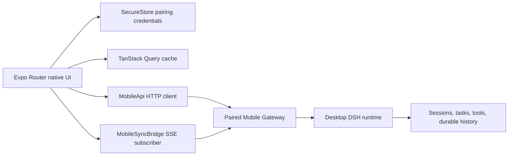

# Mobile Architecture

The native client projects desktop authority. It owns mobile navigation, rendering, pairing credential storage, and bounded cache state; it does not own an Agent Loop or a durable desktop session store.
